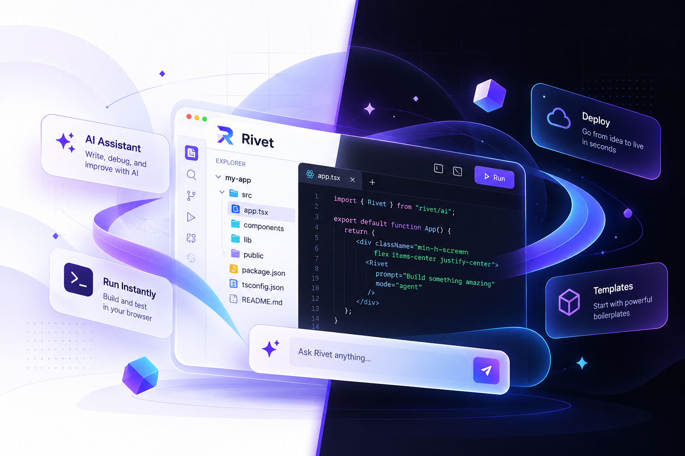

<div align="center">


# Rivet

### Build without friction.

**An AI-powered development workspace for turning ideas into working projects in the browser.**

<p>
  <a href="https://github.com/manishmotirale/Rivet-Vibe-Code-Editor">
    
  </a>
  
  
  
  
</p>

<p>
  <a href="#-what-is-rivet">What is Rivet?</a> ·
  <a href="#-current-capabilities">Capabilities</a> ·
  <a href="#-quick-start">Quick start</a> ·
  <a href="#-roadmap">Roadmap</a>
</p>

</div>

<br />

<div align="center">
  
</div>

## ✨ What is Rivet?

Rivet is a browser-first coding workspace built around a simple loop:

> **Prompt → Code → Run → Iterate**

The project combines a polished landing experience, Auth.js sign-in, a protected project dashboard, reusable starter templates, and a Prisma-backed MongoDB data model. It is being shaped into a complete AI-assisted IDE where builders can go from an idea to an interface without constantly changing tools.

> **Project status:** Rivet is an active work in progress. The public landing page, theme system, authentication foundation, dashboard UI, and project-management surfaces are in place. The full playground/editor, AI generation, and repository import experiences are still being completed.

## 🚀 Current capabilities

### Available in the application foundation

- **Responsive landing page** with a focused product story and workspace preview.
- **Google and GitHub sign-in** through Auth.js / NextAuth.
- **Protected dashboard experience** for signed-in users.
- **Project workspace entry points** for creating, viewing, editing, duplicating, deleting, and starring projects.
- **Starter template selection** for React, Next.js, Express, Vue, Hono, and Angular projects.
- **MongoDB persistence** through Prisma for users, OAuth accounts, projects, template files, stars, and chat-message data.
- **Light and dark themes** with a reusable component system.
- **Reusable UI primitives** built around shadcn/ui, Radix/Base UI, and Tailwind CSS.

### Being built next

- AI chat and streamed code generation inside a playground.
- A complete in-browser editor with live preview and run controls.
- GitHub repository selection and import. The dashboard entry point exists, but the connection flow is not wired yet.
- Project sharing, collaboration, and export workflows.

## 🧰 Technology stack

| Area                 | Technology                                                                   |
| -------------------- | ---------------------------------------------------------------------------- |
| Framework            | [Next.js 15](https://nextjs.org/) with the App Router and Turbopack          |
| Language             | [TypeScript](https://www.typescriptlang.org/)                                |
| UI                   | [React 19](https://react.dev/), Tailwind CSS 4, shadcn/ui, Radix UI, Base UI |
| Authentication       | [Auth.js / NextAuth](https://authjs.dev/) with Google and GitHub providers   |
| Database             | [MongoDB](https://www.mongodb.com/) through [Prisma](https://www.prisma.io/) |
| Components and icons | Lucide React, Sonner, React Day Picker, Embla Carousel                       |
| Data visualization   | Recharts                                                                     |
| Typography           | Poppins via `next/font`                                                      |

## 🏁 Quick start

### Prerequisites

- Node.js 20 or newer
- npm
- A MongoDB database
- OAuth credentials for Google and/or GitHub

### 1. Clone and install

```bash
git clone https://github.com/manishmotirale/Rivet-Vibe-Code-Editor.git
cd Rivet-Vibe-Code-Editor
npm install
```

### 2. Configure environment variables

Create a `.env.local` file in the project root:

```env
DATABASE_URL="mongodb+srv://<username>:<password>@<cluster>/<database>"
AUTH_SECRET="replace-with-a-long-random-secret"

GITHUB_CLIENT_ID="your-github-oauth-client-id"
GITHUB_CLIENT_SECRET="your-github-oauth-client-secret"

GOOGLE_CLIENT_ID="your-google-oauth-client-id"
GOOGLE_CLIENT_SECRET="your-google-oauth-client-secret"
```

For local development, use these callback URLs in your OAuth provider settings:

```text
http://localhost:3000/api/auth/callback/github
http://localhost:3000/api/auth/callback/google
```

Keep `.env.local` private. Never commit credentials or provider secrets.

### 3. Generate Prisma Client

```bash
npx prisma generate
```

### 4. Start the development server

```bash
npm run dev
```

Open [http://localhost:3000](http://localhost:3000) and start exploring Rivet.

## 📜 Available scripts

| Command               | Purpose                                     |
| --------------------- | ------------------------------------------- |
| `npm run dev`         | Start the development server with Turbopack |
| `npm run build`       | Create a production build                   |
| `npm run start`       | Serve the production build                  |
| `npm run lint`        | Run the configured Next.js lint command     |
| `npx prisma generate` | Generate the Prisma Client from the schema  |

## 🗂️ Project structure

```text
app/
├── (root)/              # Public landing page and home layout
├── (auth)/auth/         # Sign-in experience
├── api/auth/            # Auth.js route handler
└── dashboard/           # Authenticated project dashboard

components/
├── provider/            # Theme and application providers
└── ui/                  # Reusable UI primitives

features/
├── auth/                # Auth actions, hooks, and components
├── dashbaord/           # Dashboard and project-management UI
├── home/                # Landing page header and footer
└── playground/          # Playground action boundary

lib/                     # Shared utilities and Prisma client
prisma/                  # MongoDB schema and generated data model
public/                  # Logos, illustrations, and product previews
```

> The `dashbaord` directory name is part of the current source tree. It is intentionally shown as-is so paths in this guide match the repository.

## 🧱 Data model

The Prisma schema currently defines:

- `User` and `Account` for users and OAuth identities.
- `Playground` for a user-owned project and its selected template.
- `TemplateFile` for persisted project file content.
- `StarMark` for per-user project favorites.
- `ChatMessage` for the planned AI conversation layer.

Supported templates are `REACT`, `NEXTJS`, `EXPRESS`, `VUE`, `HONO`, and `ANGULAR`.

## 🛣️ Roadmap

- [ ] Finish the playground route and in-browser editor.
- [ ] Add AI chat with streamed code generation.
- [ ] Add live preview and run controls.
- [ ] Complete GitHub repository import and export.
- [ ] Add project sharing and collaboration.
- [ ] Add stronger validation, automated tests, and deployment documentation.

Have an idea or found a bug? Open an issue or start a discussion in the [GitHub repository](https://github.com/manishmotirale/Rivet-Vibe-Code-Editor).

## 🤝 Contributing

1. Fork the repository.
2. Create a focused branch:

   ```bash
   git checkout -b feat/your-improvement
   ```

3. Make your changes and run the relevant checks.
4. Open a pull request with a concise description and screenshots for UI changes.

Please keep changes focused, follow the existing TypeScript and component patterns, and never commit credentials or `.env` files.

## 📄 License

No license file is currently included. Add a license before distributing Rivet or accepting contributions under defined reuse terms.

<div align="center">

<br />

**Prompt. Code. Run.**

Made with ⚡ for builders who want to move from idea to interface faster.

</div>
